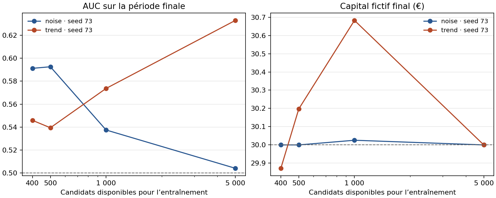

# Validation de Sentinelle sur le portefeuille fictif

## Résultat de l’expérience

La matrice principale comprend les 15 environnements du laboratoire, six actifs artificiels par environnement et la seed 41. Deux séries supplémentaires, bruit et tendance, utilisent la seed 73 et 30 600 bougies par actif. Dans chaque expérience, toutes les politiques disposent des mêmes 600 dernières bougies de quatre heures et de 30 € au départ. Les dates, paramètres générateurs, versions, fenêtres purgées, frais, coûts et empreintes des données figurent dans le JSON.

Sur 85 tailles demandées, 47 modèles ont pu être entraînés et évalués. Les 38 autres points portent leur motif d’indisponibilité. Les 17 expériences ont chacune quatre références simulées, soit le cash, une position passive plafonnée, les signaux classiques et le suivi de tendance. Le premier modèle entraînable est figé comme Champion expérimental. Le dernier modèle entraînable est le Challenger désigné avant lecture des scores. Les tailles intermédiaires servent à tracer les courbes.

| Étape | Mesure | Résultat observé |
|---|---|---|
| Ajustement | AUC et Brier sur les exemples utilisés par le modèle | Valeurs par taille dans `fit_forecast` |
| Généralisation | Prédictions sur les bougies postérieures à toutes les étapes de sélection | Tendance longue, seed 73, AUC de 0,574 à 1 000 candidats et 0,633 à 5 000. Sur bruit, l’AUC à 5 000 atteint 0,504. |
| Contribution financière fictive | Décisions du véritable agent avec coûts et contraintes | Tendance longue, 14 trades et 30,682 € à 1 000 candidats. À 5 000, zéro trade et 30,000 €. |
| Comparaison appariée finale | Espérance nette en euros, performance absolue et différence quotidienne contre le Champion | 7 expériences avec avantage net non démontré, 10 avec preuves insuffisantes et aucune promotion. |

Le score prédictif évalue le classement des candidats. Le seuil, les frais, les minimums et le risque déterminent les décisions exécutées. Les prévisions initiales de 100 exemples restent en dessous du minimum du trainer. Les environnements baissier et inactif de la matrice principale n’ont fourni aucun candidat d’entraînement admissible aux règles activées.



## Purge temporelle à cohorte identique

Avant la correction, le choix des payoffs pouvait dépendre d’une issue connue après la frontière et la calibration réutilisait les observations de sélection. Le modèle est désormais ajusté sur une première fenêtre, calibré sur une deuxième, puis son seuil et le choix éventuel des règles seules sont établis sur une troisième. Chaque étape exclut les issues non résolues ou résolues à sa borne supérieure. Le contrôle interne et la comparaison finale des portefeuilles disposent ensuite de fenêtres distinctes. Le modèle déployable conserve les paramètres évalués.

Les deux versions ont reçu 1 800 candidats de `make_candidates("simple")` par seed. Les empreintes des 359 décisions du contrôle commun coïncident pour les deux versions dans chaque essai. R désigne l’unité de risque du trade.

| Seed | Trades avant → après | AUC avant → après | Brier avant → après | R net moyen avant → après |
|---|---:|---:|---:|---:|
| 19 | 114 → 108 | 0,718 → 0,694 | 0,212 → 0,221 | 0,859 → 0,805 |
| 20 | 69 → 59 | 0,761 → 0,757 | 0,190 → 0,193 | 1,029 → 1,389 |

Les nombres de trades changent car les politiques choisissent des sous-ensembles différents du même contrôle. Les scores prédictifs diminuent sur les deux seeds. Le rendement en R des trades retenus varie dans des directions différentes. L’expérience regroupe la purge, le découpage et le gel du prédicteur. Elle ne permet pas d’attribuer une variation à une seule de ces modifications.

## Protocole statistique et portée

Les comparaisons s’appuient sur les rendements quotidiens appariés, y compris les journées sans transaction. Le bootstrap circulaire utilise des blocs de sept jours et 2 000 tirages. Les deux intervalles, performance absolue et différence contre la référence, utilisent une correction de Bonferroni par famille d’expériences. Le garde-fou exige au minimum 30 trades clôturés et quatre blocs. Les deux bornes basses, le rendement cumulé et l’espérance réalisée doivent être positifs. Le registre du panel consomme chaque fenêtre finale par horizon, conserve les versions et permet de restaurer un Champion précédemment approuvé.

Les intervalles restent conditionnels à la réalisation simulée et au choix des blocs. L’AUC publiée est descriptive. Certaines variantes partagent une règle génératrice, en particulier la disparition du signal et la corrélation trompeuse. Le nombre de scénarios ne constitue donc pas un nombre de marchés indépendants. Les frais et le glissement du meilleur volume d’entraînement disponible sont aussi testés à 0,5 et 2 fois l’hypothèse centrale, avec le modèle gelé. Le jeu OHLC ne mesure ni le rang dans un carnet ni sa profondeur historique. Les observations de cet essai ne reproduisent pas les rendements des marchés historiques de `docs/RESULTATS.md`.

## Reproduction

Utiliser l’environnement décrit dans `tools/security/README.md`. Les résultats publiés utilisent la version du moteur `0a7305634f786f1747e28a96e4dcb238f77640d1`. L’option `--suite` reproduit les deux familles. Le fichier JSON contient l’horodatage de génération.

```bash
env -i PATH=/usr/bin:/bin OPENBLAS_NUM_THREADS=1 OMP_NUM_THREADS=1 MKL_NUM_THREADS=1 /tmp/sentinelle-offline /tmp/sentinelle-env/bin/python -m tools.validation.production --suite --output /tmp/mesures
```

La figure peut être régénérée avec Matplotlib et `python -m tools.validation.plot_learning /tmp/mesures/production.json /tmp/mesures/courbes.png`. Pour la comparaison de purge, lancer `tools/validation/compare_purge.py` avec chacun des deux checkouts indiqués dans `purge.json`, sous le même lanceur sans réseau.

- [Résultats complets JSON](mesures/production.json)
- [Tableau CSV](mesures/production.csv)
- [Rapport Markdown](mesures/production.md)
- [Cohortes avant et après purge](mesures/purge.json)
